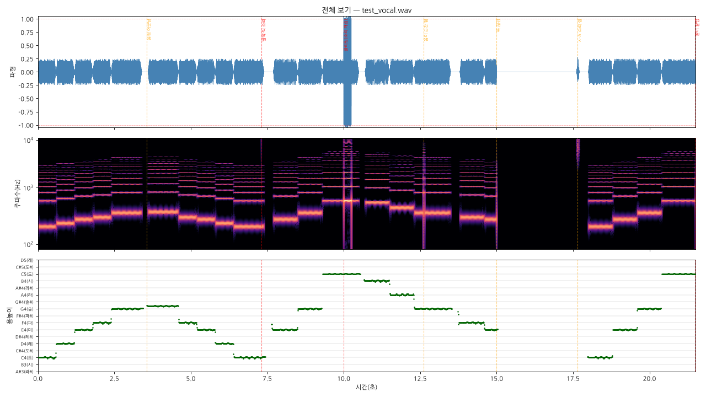
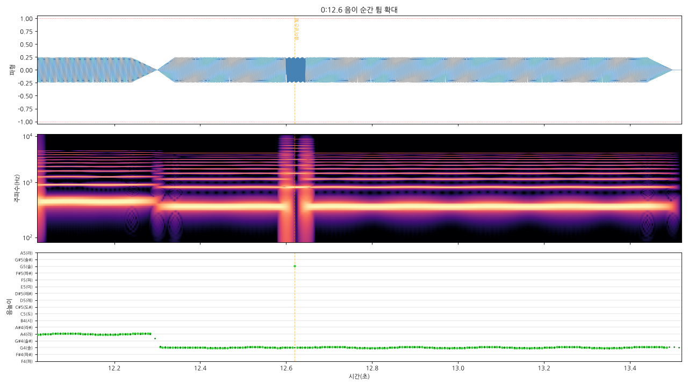

# sound-ear 🎧 — Claude가 소리를 듣게 해 주는 플러그인

[English below](#english)


Claude는 귀가 없습니다. **sound-ear**는 노래·보컬·효과음·영상 파일을 숫자와 그림(파형, 스펙트로그램, 음높이 곡선)으로 바꿔서, Claude가 직접 보고 **이상한 곳을 시각과 함께** 찾아 주게 합니다.

브이신스(Synthesizer V)·보컬로이드·UTAU·CeVIO 같은 보컬 합성 프로그램으로 만든 노래를 **올리기 전에 검수**하려고 만들었습니다.

## 찾아 주는 것

| 종류 | 찾는 것 |
|---|---|
| 소리 크기 | 클리핑(소리 깨짐), 트루 피크, 라우드니스(LUFS, 유튜브 기준 -14), 너무 크거나 작음 |
| 잡음·편집 | 딸깍·틱 소리, 뚝 끊김, 시작·끝 잘림, 바탕 잡음, 좌우 위상 반대 |
| 보컬 (보컬만 있는 파일) | 음정 어긋남(센트 단위), **음이 순간 튐**(피치 글리치), 음 흔들림, 조에 없는 음, 센 ㅅ·ㅊ 소리, 큰 숨소리, 음역 |
| 곡 정보 | 빠르기(BPM), 조(키) — 추정 |
| **가사·말 받아쓰기** | 노래 가사·대사를 시각과 함께 글로, 자막 파일(.srt)도 (Whisper) |
| **곡 설명** | 전주·절·후렴·간주 같은 구성, 반복되는 부분, 드럼·저음, 세기 변화, 분위기, 반복되는 가사(훅) |
| **보컬 분리** | 완성곡에서 목소리와 반주를 갈라 가사·음정을 더 정확하게 (UVR 모델) |
| **악기·장르·분위기 (음악 AI)** | 피아노·기타·신스·현악기 등 40가지 악기, 장르 400가지, 분위기 56가지를 구간별로 (Essentia) |

그리고 문제마다 **확대 그림**과 **그 부분만 자른 소리 조각**을 만들어서 바로 들어 볼 수 있게 합니다. 고친 뒤에는 **앞판·새판 비교**도 합니다.




*(위 그림은 일부러 흠 7개를 넣은 시험 노래입니다. 7개 모두 찾았습니다.)*

## 설치

### Claude Code
```
/plugin marketplace add rlawhddja1231-hash/sound-ear
/plugin install sound-ear@sound-ear-plugins
```

### claude.ai (웹·앱)
1. [Releases](https://github.com/rlawhddja1231-hash/sound-ear/releases)에서 `sound-ear.zip`을 받습니다.
2. claude.ai → 사용자 지정 → Skills → **+ 추가 → Skill 업로드**로 올립니다.
3. 코드 실행 기능이 켜져 있어야 합니다.

## 쓰는 법

소리 파일을 채팅에 올리고 이렇게 말하면 됩니다. Claude는 `full` 명령 하나로 흠 찾기·목소리 분리·음정·가사·곡 설명을 다 하고 **종합보고서**를 줍니다.

- "이 노래 들어 보고 이상한 데 찾아 줘"
- "보컬만 뽑은 거야. 음정이랑 음 튀는 데 봐 줘"
- "고친 판이야. 전이랑 비교해 줘"
- "이 노래 어떤 노래인지 설명해 줘" / "가사 받아 적어 줘"

**가사 받아쓰기 준비(한 번만):** [whisper.cpp 모델](https://huggingface.co/ggerganov/whisper.cpp)에서 `ggml-small-q5_1.bin`(190MB, 빠름) 또는 한국어 가사가 훨씬 정확한 `ggml-medium-q5_0.bin`(539MB)을 받아 Claude에게 주세요. 없어도 다른 기능은 다 됩니다.

**보컬 분리 준비(한 번만):** [Kim_Vocal_2.onnx](https://github.com/TRvlvr/model_repo/releases/download/all_public_uvr_models/Kim_Vocal_2.onnx)(67MB)를 받아 Claude에게 주세요.

**악기·장르·분위기 준비(한 번만):** [Essentia 모델](https://essentia.upf.edu/models/)에서 파일 7개(약 26MB, 목록은 SKILL.md)를 받아 Claude에게 주세요. 이 모델은 **비상업용만 무료(CC BY-NC-ND)**라 이 저장소에는 넣지 않았습니다.

**팁:** 보컬 합성 노래는 **보컬만 따로 내보낸 wav + 완성곡 wav**를 같이 주면 가장 정확합니다. 반주가 섞이면 음정 검사가 틀립니다.

## 못 하는 것
- 마이크로 실시간 듣기 (파일만)
- "좋은 노래인가" 같은 취향 판단
- mp3·유튜브 녹음처럼 손실 압축된 파일에서는 클리핑을 참고로만 봅니다

## 필요한 것
Python 3, ffmpeg, 그리고 `librosa soundfile pyloudnorm matplotlib koreanize-matplotlib scipy` (Claude가 알아서 설치합니다). 가사 받아쓰기는 `pywhispercpp`와 모델 파일이 더 필요합니다.

## 직접 시험해 보기
```
python3 plugins/sound-ear/skills/sound-ear/tests/selftest.py
python3 plugins/sound-ear/skills/sound-ear/tests/mixtest.py
```
흠 7개를 넣은 시험 노래를 만들어 다 찾는지 봅니다. `PASS`가 나오면 정상입니다.

## 헛짚었거나 놓쳤을 때
실제 노래로 써 보고 틀린 곳이 있으면 [Issues](https://github.com/rlawhddja1231-hash/sound-ear/issues)에 시각과 함께 알려 주세요. 기준값을 고쳐 나갑니다.

---

<a id="english"></a>
# English

**sound-ear** lets Claude "hear" audio. A bundled Python script turns songs, vocals, sound effects or video soundtracks into numbers and pictures (waveform, spectrogram, pitch curve), so Claude can inspect them and point out problems with exact timestamps:

- **Levels:** clipping, true peak, integrated loudness (LUFS), too loud / too quiet
- **Noise & edits:** clicks, abrupt cuts, cut-off start/end, noise floor, phase cancellation
- **Vocals (vocal-only file):** off-pitch notes (in cents), pitch glitches, wobbly notes, out-of-key notes, harsh sibilance, loud breaths, vocal range
- **Song info:** estimated BPM and key
- **Lyrics/speech:** timestamped transcription and .srt subtitles (whisper.cpp; model file `ggml-small-q5_1.bin` from Hugging Face)
- **Describe:** sections (intro, verse, chorus, breaks), repeats, drums and bass, loudness changes, mood, repeated lyric hooks
- **Vocal separation:** split a full mix into vocals and backing (UVR MDX-Net, optional model download) for better lyrics and pitch checks on finished songs
- **Instruments, genre, mood (music AI):** 40 instruments, 400 genres, 56 moods per section with optional Essentia models (non-commercial license; download them yourself)

For each finding it makes a close-up picture and a short audio snippet, and it can compare two versions after you fix things. Built for checking vocal-synth songs (Synthesizer V, VOCALOID, UTAU, CeVIO) before release. Report labels are Korean; Claude answers in your language.

**Install (Claude Code)**
```
/plugin marketplace add rlawhddja1231-hash/sound-ear
/plugin install sound-ear@sound-ear-plugins
```
**Install (claude.ai):** download `sound-ear.zip` from Releases and upload it under Customize → Skills → Upload skill (code execution must be enabled).

**Usage:** attach an audio file and ask "listen to this and find problems". Claude runs `full` (separation → checks → description) and gives you a one-page summary report. For best pitch results, give a vocal-only export plus the full mix.

**Limits:** files only (no live mic), no taste judgements; clipping on lossy files (mp3, opus) is advisory only.

**Self-test:** `python3 plugins/sound-ear/skills/sound-ear/tests/selftest.py` → `PASS`.

License: MIT
